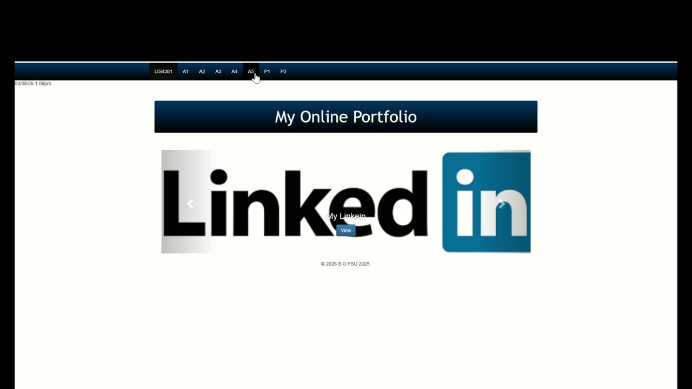
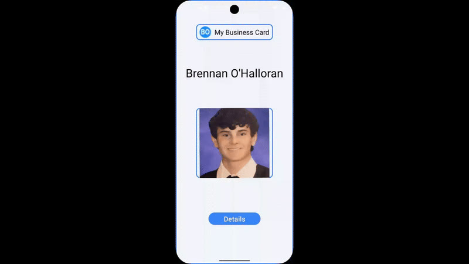
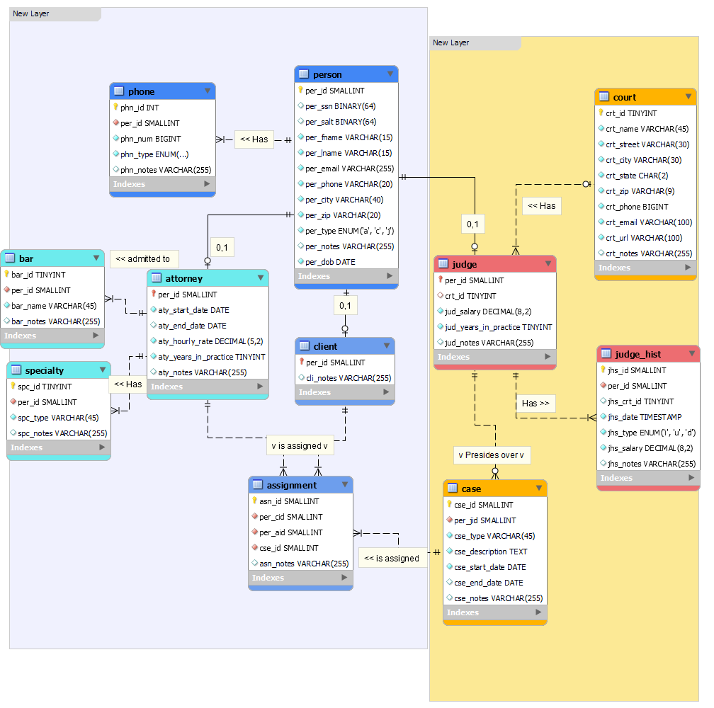
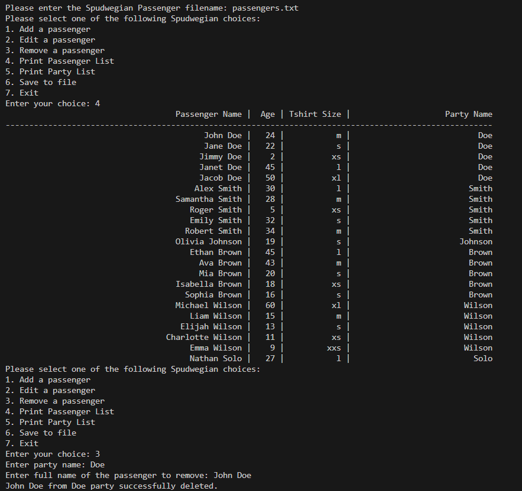

# Brennan O'Halloran — Cybersecurity Portfolio

[](https://brenohal.github.io/brennan-resume/)
[](https://github.com/brenohal/brennan-resume/actions/workflows/ci.yml)
[](https://astro.build/)

<table>
  <tr>
    <td width="190" align="center"></td>
    <td>
      <h2>Security operations, automation &amp; cyber risk</h2>
      <p>Internal SOC Analyst at Henry Schein and Florida State University IT graduate, <em>magna cum laude</em>. I build practical security workflows and make risk easier to act on.</p>
      <p><a href="https://brenohal.github.io/brennan-resume/">Portfolio</a> · <a href="https://brenohal.github.io/brennan-resume/resume/">Résumé</a> · <a href="mailto:Brennan.ohal1@gmail.com">Email</a> · <a href="https://www.linkedin.com/in/brennan-o-halloran">LinkedIn</a></p>
    </td>
  </tr>
</table>

| **14%** | **4** | **3.86** |
|:---:|:---:|:---:|
| fewer global firewall rules | roles at Henry Schein | GPA · Magna Cum Laude |

## What I work on

- Investigating security cases with Torq and SentinelOne
- Automating firewall-rule analysis with Python and Palo Alto Panorama
- Building threat-intelligence and SOAR workflows for zero-day response
- Translating cyber exposure into business terms with the FAIR model

My experience spans GSOC operations, firewall management, secure software testing, and executive risk communication. The portfolio also includes coursework in web development, databases, and systems programming.

## What this project demonstrates

- A fast, static site generated with [Astro](https://astro.build/)
- Content-driven pages backed by typed, build-validated JSON data
- Responsive layouts with light and dark themes
- Accessible interactions tested with Playwright and axe-core
- A strict Content Security Policy and self-hosted fonts
- Generated metadata, sitemap, canonical URLs, and Open Graph imagery
- GitHub Pages deployment with automated CI quality gates

## Selected projects

### AI-Driven Job Application Engine

An active personal build that ranks roles, tailors résumé content, and fills multi-page application forms up to the final review. Its LLM router handles provider rate limits and failover; safety checks verify each form entry and keep submission in my hands.

The code is in a private repository, but the [public case study](https://brenohal.github.io/brennan-resume/work/job-application-engine/) walks through the design, safeguards, and workflow.

### Project snapshots

|  |  |
|:---:|:---:|
| [](https://github.com/brenohal/web-application-development-java)<br>**[Dynamic CRUD Web Application](https://github.com/brenohal/web-application-development-java)**<br>Java · MySQL · server-side validation | [](https://github.com/brenohal/mobile-web-application-development)<br>**[Interactive Mobile Business Card](https://github.com/brenohal/mobile-web-application-development)**<br>PHP · JavaScript · mobile-first design |
| [](https://github.com/brenohal/advanced-database-design-sql)<br>**[Advanced Database Design](https://github.com/brenohal/advanced-database-design-sql)**<br>T-SQL · normalization · data warehousing | <br>**Spudwegian Cruise Booking System**<br>C++ · file I/O · input validation |

## Tech stack

`Astro` · `TypeScript` · `JavaScript` · `HTML` · `CSS` · `Playwright` · `axe-core` · `GitHub Actions` · `GitHub Pages`

## Run it locally

This project requires Node.js `22.12+`.

```bash
git clone https://github.com/brenohal/brennan-resume.git
cd brennan-resume
npm install
npm run dev
```

Then open the local URL printed by Astro.

## Useful commands

| Command | Purpose |
| --- | --- |
| `npm run dev` | Start the local development server |
| `npm run build` | Type-check, generate assets, build the site, and run the output quality gate |
| `npm run preview` | Preview the production build locally |
| `npm run check` | Run Astro's type and content checks |
| `npm run lint` | Run oxlint |
| `npm test` | Run accessibility and behavior tests in desktop and mobile viewports |
| `npm run deploy` | Publish `dist/` to the `gh-pages` branch manually |

## Where to edit content

Most portfolio content is data-driven, so updates usually do not require editing components.

| Content | File |
| --- | --- |
| Name, headline, bio, contact links, and impact metrics | `src/data/personal.json` |
| Work history | `src/content/experience.json` |
| Projects | `src/content/projects.json` |
| Education | `src/data/education.json` |
| Flagship case study | `src/data/caseStudy.json` |
| Résumé PDF | `public/assets/resume.pdf` |
| Site URL, form endpoint, and analytics | `src/site.config.ts` |

The schemas are defined in `src/content.config.ts`, so invalid content is caught during the build.

## Quality and security

`npm run build` ends with a custom output check that verifies the generated site for:

- A strict CSP without `unsafe-inline` or `unsafe-eval`
- Unexpected third-party origins
- Broken internal links
- Missing image alt text and page metadata
- One page-level `<h1>` per page
- JavaScript and CSS size budgets

The CI workflow also runs linting, the production build, a production dependency audit, and the complete browser test suite. GitHub Actions is configured with read-only repository permissions and pinned action commits.

## License

This is a personal portfolio. The source is public for reference, but the content, résumé, branding, and media are not licensed for reuse.
